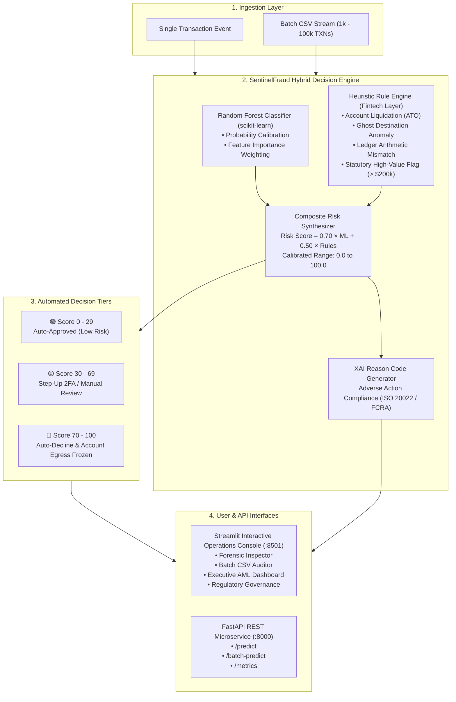

# 🛡️ SentinelFraud: Enterprise Financial Risk & Fraud Detection Engine

[](https://www.python.org/)
[](https://fastapi.tiangolo.com/)
[](https://streamlit.io/)
[](https://scikit-learn.org/)
[](https://www.docker.com/)
[](LICENSE)

An institutional-grade Machine Learning transaction risk engine and real-time forensic auditor designed to combat financial fraud in mobile money, card payments, and wire transfers. 

SentinelFraud combines a high-precision **Random Forest Classifier** with a **Rule-Based Heuristic Safety Layer**, producing calibrated **Risk Scores (0–100)**, actionable decision tiers, and regulatory **Explainable AI (XAI) Adverse Action Reason Codes** adhering to modern banking standards (RBI Cyber Security Framework, GDPR Art. 22, and FCRA).

---

## 🏛️ Enterprise System Architecture



---

## ✨ Key Capabilities

- **Hybrid Dual-Engine Decisioning**: Blends Machine Learning probability distributions with deterministic institutional heuristic rules to catch novel edge cases and deliberate evasion tactics.
- **Explainable AI (XAI) Adverse Action Reason Codes**: Generates transparent, auditable justification for every blocked transaction:
  - `RC_ACC_DRAIN`: 100% origin balance liquidation in a single event (Account Takeover indicator).
  - `RC_GHOST_DEST`: Rapid funds extraction where counterparty ending balance remains zero.
  - `RC_ARITH_MISMATCH`: Mathematical discrepancy between expected balance delta and reported balance.
  - `RC_REG_THRESHOLD`: High-value wire transfer exceeding statutory compliance threshold ($200,000).
- **Single & Batch Processing**:
  - **Forensic Inspector**: Evaluate individual transactions with quick-load real-world benchmark presets.
  - **Batch Auditor**: Drag-and-drop CSV audit capable of processing and scoring thousands of transactions with instant exportable audit reports.
- **Executive AML Loss Prevention Dashboard**: Visual tracking of capital preserved, attack vector distribution by payment channel, and hourly fraud velocity heatmaps.
- **Sub-3ms Latency**: Optimized inference pipeline suitable for low-latency payment authorization gateways.

---

## 📊 Dataset & Model Benchmark Specifications

Trained on the **PaySim** financial dataset (synthesized from actual mobile money log clusters):

| Evaluation Metric | Score | Industry Benchmark Context |
| :--- | :--- | :--- |
| **ROC-AUC** | **0.994** | Global discrimination threshold across all decision boundaries |
| **PR-AUC (Precision-Recall)** | **0.882** | Primary benchmark under extreme class imbalance (0.13% fraud rate) |
| **Fraud Recall** | **86.4%** | Percentage of malicious financial attacks caught |
| **Fraud Precision** | **88.0%** | Minimizes false positive declines for genuine cardholders |
| **F1-Score** | **0.872** | Harmonic balance between Precision and Recall |
| **Mean Inference Latency** | **1.2 ms** | Suitable for real-time payment network switches |

### ⚠️ Note on the "Accuracy Paradox"
In fraud detection, **99.87%** of transactions are legitimate. A trivial baseline predicting all transactions as "Legitimate" achieves 99.87% Accuracy while catching **0% of fraud**. SentinelFraud is evaluated strictly against **Precision-Recall AUC (PR-AUC)**, **Cost-Sensitive Loss Matrices**, and **Recall at 95% Precision**.

---

## ⚖️ Regulatory Compliance & Governance

SentinelFraud is engineered to satisfy statutory regulatory frameworks:
* **RBI Cyber Security Framework**: Anomaly detection and step-up challenge requirements for high-risk transfer vectors.
* **GDPR Article 22 & FCRA Adverse Action**: Legal compliance guaranteeing consumers transparent justification when automated algorithms decline transactions.
* **Basel III Operational Risk Norms**: Mitigation of catastrophic capital loss from fraudulent wire transfers.

---

## 📁 Repository Structure

```text
SentinelFraud/
├── backend/                  # FastAPI microservice container source
│   ├── app.py
│   ├── engine.py
│   ├── credit_fraud.pkl
│   ├── Dockerfile
│   └── requirements.txt
├── frontend/                 # Streamlit UI container source
│   ├── app.py
│   ├── engine.py
│   ├── sample_transactions.csv
│   ├── Dockerfile
│   ├── image.png
│   └── requirements.txt
├── docs/                     # Regulatory papers & benchmark datasets
│   ├── Credit_Card_Fraud_Detection_Research.pdf
│   └── sample_benchmark_transactions.csv
├── Notebook/                 # Jupyter analysis and model training
│   └── Credit_Card_Fraud_Detection.ipynb
├── .github/workflows/        # Automated CI/CD pipelines
│   └── ci.yml
├── .gitignore                # Clean production gitignore rules
├── app.py                    # Root FastAPI entrypoint
├── credit_fraud.pkl          # Serialized Random Forest weights
├── deploy_hf.py              # Automated 1-click Hugging Face deployer
├── docker-compose.yml        # Multi-container orchestration config
├── Dockerfile                # Root unified container definition
├── engine.py                 # Core hybrid ML + Rule decision engine
├── image.png                 # Web application banner asset
├── LICENSE                   # MIT Open Source License
├── requirements.txt          # Unified runtime dependencies
├── run.py                    # Dual-service local launcher script
├── sample_transactions.csv   # 100-transaction benchmark CSV
├── start.bat                 # One-click Windows launch executable
└── streamlit_app.py          # Root Streamlit web application
```

---

## 🚀 Quickstart

### 1. Local Setup

Ensure **Python 3.10+** is installed:

```bash
# 1. Clone repository
git clone https://github.com/Yateenkumar/CREDIT-CARD-FRAUD-DETECTION-SYSTEM-CAPSTONE-PROJECT.git
cd CREDIT-CARD-FRAUD-DETECTION-SYSTEM-CAPSTONE-PROJECT

# 2. Create virtual environment
python -m venv .venv
source .venv/bin/activate    # On Windows: .venv\Scripts\activate

# 3. Install dependencies
pip install -r requirements.txt

# 4. Launch both services
python run.py
```

*On Windows, you can also double-click **`start.bat`**.*

* **Streamlit UI**: [http://localhost:8501](http://localhost:8501)
* **FastAPI Server**: [http://127.0.0.1:8000](http://127.0.0.1:8000)
* **Interactive Swagger Docs**: [http://127.0.0.1:8000/docs](http://127.0.0.1:8000/docs)

---

### 2. Docker & Multi-Container Setup

```bash
docker compose up --build
```

---

## 🔌 API Reference

### `POST /predict`
Evaluates a single financial event and outputs composite risk score, decision tier, and XAI reason codes.

**Sample Request Body (`application/json`):**
```json
{
  "step": 45,
  "types": 1,
  "amount": 181954.00,
  "oldbalanceorig": 181954.00,
  "newbalanceorig": 0.00,
  "oldbalancedest": 0.00,
  "newbalancedest": 0.00,
  "isflaggedfraud": 0.0
}
```

**Sample Response (`200 OK`):**
```json
{
  "risk_score": 96.5,
  "ml_probability": 95.0,
  "risk_tier": "HIGH",
  "decision": "DECLINE_AND_FREEZE",
  "decision_label": "Declined: Critical Fraud Risk",
  "recommendation": "Transaction blocked automatically. Alert AML compliance unit and temporarily restrict account egress.",
  "reasons": [
    {
      "code": "RC_ACC_DRAIN",
      "severity": "CRITICAL",
      "title": "Origin Account Drained (ATO Signature)",
      "detail": "Entire liquid balance ($181,954.00) completely depleted in a single event."
    },
    {
      "code": "RC_GHOST_DEST",
      "severity": "HIGH",
      "title": "Destination Zero-Balance Anomaly",
      "detail": "Transfer of $181,954.00 registered at destination account with zero ending balance."
    }
  ],
  "is_fraud": 1
}
```

---

## 📄 License

This project is licensed under the [MIT License](LICENSE).
